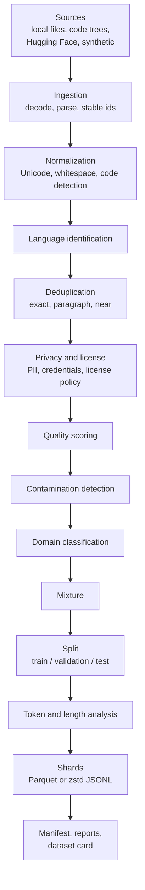

# DataForge-LLM

**Production-grade pretraining data engineering for large language models.**

DataForge-LLM is a reproducible pretraining-data engineering framework for turning heterogeneous raw corpora into deduplicated, quality-filtered, privacy-aware, contamination-controlled, provenance-tracked model-ready datasets.

It runs on a CPU-only laptop. Stages stream documents in fixed-size batches, checkpoint their
progress, and record what they did, so a dataset version can be audited down to the source
record and rebuilt byte for byte from its manifest.

[Quickstart](#quickstart) · [Measured results](#measured-results) ·
[Example report](examples/demo-output/reports/report.md) · [Documentation](docs/README.md)

## Why DataForge-LLM

Pretraining data is usually assembled by one-off scripts: a dedup notebook here, a language
filter there, a license spreadsheet somewhere else. The result is hard to reproduce, hard to
audit, and easy to contaminate with evaluation data. DataForge treats a pretraining dataset as
a build artifact:

- **Declared inputs.** Sources live in a registry with their license, usage policy, and
  version. Licenses are never guessed; unknown licenses are rejected by default.
- **One pipeline, one configuration.** A typed YAML file defines every stage. Its
  output-affecting parts are hashed, and the hash, the code fingerprint, and the source
  fingerprints together identify the dataset.
- **Immutable, content-addressed versions.** A dataset is published only after it passes
  integrity validation, and a published version is never overwritten.
- **Every decision is recorded.** Each removed document has an audit row (stage, reason,
  bytes); each kept document carries its provenance and transformation history.
- **Evaluation data stays out.** Benchmarks are checked with four detection methods, and
  evidence is stored as offsets and hashes, never as benchmark text.
- **Laptop-scale by design, not by accident.** Streaming stages, bounded batches, disk
  budgets, and resumable checkpoints mean text is never held in memory; what grows with the
  corpus is a small fixed-size key per document for exact deduplication.

Every number in this README comes from a recorded run.

## Measured results

### Demo pipeline

`configs/pipelines/demo.yaml` on the synthetic sample corpus (9 sources, deliberately seeded
with duplicates, PII, fake credentials, junk pages, benchmark leaks, foreign-language pages,
corrupted records, and unknown or disallowed licenses). The complete output is committed in
[`examples/demo-output/`](examples/demo-output/).

| Stage | Documents in | Removed | Reason |
| :--- | ---: | ---: | :--- |
| Ingestion | - | - | 1,501 documents from 9 sources; 3 malformed records logged |
| Language | 1,501 | 66 | not English |
| Exact dedup | 1,435 | 76 | 70 duplicate groups (largest: 3) |
| Near dedup | 1,359 | 33 | 33 clusters at Jaccard >= 0.85 |
| PII / credentials | 1,326 | 0 | 140 PII and 14 credential spans redacted in place |
| License | 1,326 | 113 | 58 disallowed, 55 unknown |
| Quality | 1,213 | 22 | too short (13), boilerplate (9) |
| Contamination | 1,191 | 19 | demo math and code benchmark leaks |
| Mixture | 1,172 | 703 | token-weighted domain mixture (9 domains, every target met within 0.2 points) |
| **Output** | **469** | | 4 Parquet shards, 121,919 estimated tokens, train / validation / test = 420 / 25 / 24 |

End to end, including reports and validation, the run takes 5.9 s with a peak RSS of 392 MB.
Rebuilding the committed example from its manifest is bit-identical on Windows and on Linux
(Docker).

### Filter accuracy against planted ground truth

The [removal attribution experiment](experiments/removal_attribution/) runs the demo pipeline
on a twice-as-large corpus (3,001 documents, seed 7), once in pipeline order and once with
every filter in annotate mode, and scores each filter against the generator's labels.

| Phenomenon | Planted | Recall | Precision |
| :--- | ---: | ---: | ---: |
| Exact-duplicate groups reduced to one copy | 130 groups | 100% | - |
| Near-duplicate groups (Jaccard >= 0.85) reduced to one copy | 80 groups | 97.5% | - |
| Documents with PII detected | 180 | 100% | 100% |
| Code files with credentials detected | 28 | 100% | 100% |
| Benchmark leaks removed (exact, substring, paraphrase) | 44 | 93.2% | 100% |
| Bad or unknown licenses rejected | 222 | 100% | 100% |
| Low-quality pages removed by some stage | 120 | 100% | - |

Paraphrased leaks are the hard case: 10 of 12 are caught, against 24 of 24 substring leaks.
Under the default `redact` policy, the privacy stages remove no documents; they replace 308
spans (280 PII, 28 credentials) with typed placeholders, shrinking the text by 5,913 bytes.
The figures measure the filters on synthetic phenomena, not on real web text; the
[full results](experiments/removal_attribution/results/RESULTS.md) include filter overlaps and
all definitions.

### Real web text

[`configs/pipelines/public-c4.yaml`](configs/pipelines/public-c4.yaml) streams the first 2,000
documents of the C4 English validation split (pinned revision) from Hugging Face and runs the
default filters:

| Stage | Removed | Detail |
| :--- | ---: | :--- |
| Language | 16 | not English |
| Exact and near dedup | 0 | one near-duplicate candidate pair, rejected on verification |
| PII | 0 | 154 detections redacted in 84 documents (phone 106, email 44, IP 4) |
| Quality | 148 | too short 78, repeated n-grams 21, too few stopwords 20, boilerplate 12, other 17 |
| **Kept** | **1,836 of 2,000 (91.8%)** | 3.89 MB of text, about 1.0 million estimated tokens |

The run takes 22.6 s end to end, 10.4 s of it ingestion while streaming from the Hub, with a
peak RSS of 290 MB.
There are no ground-truth labels for this text, so these counts show behaviour, not accuracy;
the PII figures are detections, not verified personal data.

### Performance

Single process on the development laptop (Windows 11, 12 logical cores, 15.6 GiB RAM):

- **Larger than RAM:** 17.0 GiB of text (16.9 million documents) streamed through ingestion,
  normalization, and exact-dedup key collection in 18 minutes (16.1 MB/s) with a peak RSS of
  1.16 GB. RSS grows by about 66 bytes per document, the size of the exact-dedup keys; text is
  never accumulated.
- **Full pipeline:** 294 documents/s with every stage except the mixture enabled (7,501
  documents), peak RSS 398 MB.

Details and micro-benchmarks are under [Benchmarks](#benchmarks).

## Architecture



The code is layered: the CLI calls an application layer (runner, executor, stage DAG), which
drives domain logic (documents, dedup, quality, privacy, contamination, mixtures) through
ports with local adapters. Library-specific code stays at the edges: **Arrow and Parquet** for
the canonical schema, parts, and shards; **DuckDB** for validation, inspection, and SQL;
**Polars** for lazy analytics over audit logs; **NumPy** for vectorized MinHash, LSH, and
mixture selection. See [architecture](docs/architecture/overview.md) and
[ADR-001](docs/adr/ADR-001-polars-arrow-duckdb.md).

## Pipeline

`dataforge pipeline plan configs/pipelines/demo.yaml` shows the DAG without reading data:

| Stage | Kind | What it does |
| :--- | :--- | :--- |
| `normalize` | streaming | Unicode NFC, control and zero-width characters, whitespace; code-aware |
| `language` | streaming | Language identification behind a pluggable detector port |
| `exact_dedup` | barrier | Normalized-content xxh3-128 hash groups |
| `paragraph_dedup` | streaming | Bloom-filter removal of repeated paragraphs (off in the demo) |
| `near_dedup` | barrier | MinHash + LSH clusters with deterministic representatives |
| `pii`, `secrets` | streaming | Detect, redact, or drop PII and credentials |
| `license` | streaming | License and usage-policy gate |
| `quality` | streaming | Fifteen heuristic signals, optional learned model |
| `contamination` | streaming | Benchmark overlap detection |
| `classify` | streaming | Rule-based domain labels |
| `mixture` | barrier | Weighted domain mixture by documents, bytes, or tokens |
| `split` | streaming | Group-aware train / validation / test assignment |
| `analyze` | streaming | Token and length statistics |

Streaming stages process one batch at a time. A barrier stage needs the whole corpus, so it
*observes* every document, *finalizes* a decision table, and *applies* it in the next pass.
The executor fuses consecutive operators into segments that end in one materialization (four
for the demo), commits each part atomically (every 20,000 documents by default), resumes
after a crash or a full disk, and caches finished segments by fingerprint, so changing a late stage reruns
only what depends on it. Each stage can run in `filter` mode (remove) or `annotate` mode
(flag only). Details: [pipeline execution](docs/architecture/pipeline.md).

## Data quality

Fifteen signals, each with a configurable threshold and the content kinds it applies to
(prose, code, or both): length, alphabetic words, mean word length, sentence length, symbol
ratio, alphanumeric ratio, stopword ratio, terminal punctuation, line repetition, n-gram
repetition, character entropy, boilerplate phrases, URL ratio, language confidence, and code
line length. Signals combine with `all_required` (every applicable signal must pass) or
`min_score`, and a learned quality model can be plugged in as a `module:factory` reference. Each kept document
stores its signal values; the report shows per-signal failure rates and score distributions.
Heuristics are not human judgements of quality. See [quality](docs/methodology/quality.md).

## Deduplication

- **Exact:** xxh3-128 over normalized content; groups are formed by sorting, and the policy
  (`keep_first`, `keep_longest`, or `keep_highest_quality`) chooses the survivor.
- **Paragraph:** a Bloom filter drops paragraphs already seen elsewhere in the corpus.
- **Near:** word 5-gram shingles, 128-permutation MinHash, and LSH whose band layout is
  chosen to keep candidate recall at or above 98% at the 0.85 Jaccard threshold (13 bands x 8
  rows). Candidates are verified on signatures and merged with union-find; cluster ids and
  representatives are deterministic.
- **No leakage:** splits are assigned per duplicate group, so a cluster never spans train and
  test, and validation checks it.

See [deduplication](docs/methodology/deduplication.md) and
[ADR-003](docs/adr/ADR-003-exact-and-near-dedup.md).

## Contamination

Protected benchmarks are declared in
[`benchmarks/contamination/registry.yaml`](benchmarks/contamination/registry.yaml), with the
fields to protect and their licenses. Four methods run per document: exact match after
normalization, normalized substring, word n-gram containment (8-grams, 0.5 by default), and
MinHash similarity (0.8). Policies are `flag`, `drop`, or `fail`. Evidence is stored as
character offsets plus a short hash of the benchmark field, never benchmark text. DataForge
never downloads benchmark material: two synthetic CC0 benchmarks are committed, and GSM8K,
HumanEval, and MBPP can be added locally by hand under their licenses. See
[contamination](docs/methodology/contamination.md).

## Privacy

- **PII:** email addresses, phone numbers, payment cards (Luhn check), IBANs (mod-97 check),
  IP addresses, and US social security numbers.
- **Credentials:** AWS, GitHub, GitLab, Slack, Stripe, Google, Hugging Face, and OpenAI key
  formats, private key blocks, and password or high-entropy assignments.
- **Policies:** `detect`, `redact` (typed placeholders such as `<EMAIL>`), or `drop`.
- **Logging:** detected values never appear in logs, reports, or artifacts; only types,
  counts, and offsets do.

Pattern-based detection misses PII without a fixed shape, such as names and street
addresses. See [privacy](docs/governance/privacy.md).

## Licensing

License identifiers are declared per source or per record, normalized to SPDX where an
unambiguous mapping exists, and never inferred from content. The license stage keeps an
allow-list; unknown licenses are rejected by default, and disallowed ones are rejected or
fail the run. The report and dataset card list every license with its document count. This
is policy tooling, not legal advice, and does not certify compliance. See
[licensing](docs/governance/licensing.md).

## Mixtures

The mixture stage samples domains to target weights in documents, bytes, or tokens. With
available amounts *A_d* and weights *w_d*, the largest achievable total is *T* = min *A_d* /
*w_d*; documents are taken in seeded-hash order within each domain, so a mixture is
deterministic and stable when unrelated documents are added. Weights renormalize when a
domain is missing. The report compares target and achieved weights. See
[mixtures](docs/methodology/mixtures.md).

## Provenance

- `document_id` hashes the source, the record key, and the raw content; `content_hash`
  follows every text change.
- Each document carries its source URI, record locator (for example `web.jsonl#L42` or
  `bundle.zip!a/b.txt`), source version and fingerprint, and the ordered list of
  transformations applied to it.
- `manifest.json` records the code (version, Git SHA, code fingerprint), the full
  output-affecting configuration and its hash, every source file's SHA-256, every benchmark
  file's SHA-256, per-stage statistics, and every shard's SHA-256.
- `dataforge pipeline reproduce <manifest>` refuses to run if the configuration or the source
  content changed, rebuilds from scratch, and compares every shard byte for byte.

See [provenance](docs/governance/provenance.md), [ADR-004](docs/adr/ADR-004-provenance-model.md),
and [ADR-006](docs/adr/ADR-006-immutable-dataset-versions.md).

## Quickstart

Requirements: Python 3.11 or newer, [uv](https://docs.astral.sh/uv/), and Git. No GPU, no
network access after installation.

```bash
git clone https://github.com/M-amir1998/DataForge-LLM.git
cd DataForge-LLM
uv sync
uv run dataforge doctor                              # Python, RAM, disk, libraries
```

Look at the committed example without running anything:

```bash
uv run dataforge dataset validate examples/demo-output
uv run dataforge dataset inspect examples/demo-output
uv run dataforge dataset sql examples/demo-output "SELECT split, count(*) FROM docs GROUP BY split"
```

Run the demo end to end:

```bash
uv run dataforge sample generate data/sample         # deterministic synthetic corpus
uv run dataforge pipeline plan configs/pipelines/demo.yaml
uv run dataforge pipeline run configs/pipelines/demo.yaml
uv run dataforge report latest                       # summary and path of report.md
uv run dataforge pipeline reproduce examples/demo-output/manifest.json
```

Datasets are published under `.dataforge/datasets/<name>/<version>/`. Individual stages can be
explored with `dataforge dedup exact|near`, `quality analyze`, `privacy scan`,
`contamination scan`, `mixture build`, and `sources list|inspect`; `pipeline run --until
<stage>`, `--dry-run`, and `--no-cache` control execution. Exit codes are stable per error
type.

An optional real-data example streams 2,000 documents of C4 from Hugging Face
(`uv sync --extra hf`, then `uv run dataforge pipeline run configs/pipelines/public-c4.yaml`).

With Docker instead of a local Python:

```bash
docker build --target runtime -t dataforge-llm .
docker run --rm --user "$(id -u):$(id -g)" -v "$PWD:/work" dataforge-llm sample generate data/sample
docker run --rm --user "$(id -u):$(id -g)" -v "$PWD:/work" dataforge-llm pipeline run configs/pipelines/demo.yaml
```

`--user` lets the container write to the mounted checkout as your own user.

## Jenkins CI

CI is a declarative [`Jenkinsfile`](Jenkinsfile); the repository intentionally has no GitHub
Actions workflows ([ADR-005](docs/adr/ADR-005-jenkins-not-github-actions.md)). Stages: lock
validation, formatting, lint, strict type checking, unit and integration tests, a smoke
pipeline run with dataset validation, property-based tests with an 85% coverage gate, secret
scanning of the working tree and Git history, a dependency vulnerability audit, package build,
and distribution checks; Docker builds and benchmarks are optional parameters. The
`Jenkinsfile` passes the declarative linter of Jenkins 2.580.2 LTS. Setup, agents, webhook,
and credentials: [docs/ci/jenkins.md](docs/ci/jenkins.md).

## Benchmarks

Measured on synthetic data (nothing downloaded) on the development laptop: Windows 11,
12 logical cores, 15.6 GiB RAM, Python 3.12, one process.

| Benchmark | Input | Wall time | Throughput | Peak RSS |
| :--- | ---: | ---: | ---: | ---: |
| Streaming: ingestion, normalization, exact-dedup keys | 17.0 GiB, 16.9 M documents | 1,081 s | 16.1 MB/s | 1,163 MB |
| Full pipeline (smoke configuration, mixture off) | 7,501 documents, 7.5 MB | 25.6 s | 294 documents/s | 398 MB |
| Near dedup: MinHash (128) signatures, LSH, verification | 50,000 documents, 50.7 MB | 21.3 s | 2,345 documents/s | 302 MB* |
| Quality scoring, 15 signals | 50,000 documents, 50.7 MB | 13.8 s | 3,632 documents/s | 215 MB* |
| Exact dedup grouping of precomputed content hashes | 200,000 documents | 0.48 s | 419,684 documents/s | 630 MB* |
| Parquet write, zstd level 3 | 50,000 documents, 50.7 MB | - | 115 MB/s write, 1,466 MB/s read, 6.5x smaller than the text | 627 MB* |

\* Includes the input corpus that the micro-benchmarks hold in memory. MB = 2^20 bytes.

In the full pipeline, contamination checking (5.5 s) and ingestion and parsing (4.5 s) take
the most time, followed by near dedup (2.8 s), credential scanning (2.2 s), quality (1.9 s),
and PII (1.6 s). Near dedup is dominated by MinHash signature computation (21.0 of 21.3 s).

Run them yourself with `benchmarks/performance/run.py`; results are appended to
[`benchmarks/performance/results/`](benchmarks/performance/results/RESULTS.md) together with
the machine, library versions, and memory measurements. See
[benchmarks](benchmarks/README.md).

## Example report

Each dataset version ships a Markdown report, a dataset card, and SVG charts. From the
[demo report](examples/demo-output/reports/report.md):


The report covers sources, the before/after funnel, removal reasons and attribution by
source, deduplication, quality signals, privacy, licenses, contamination by benchmark,
domains, the mixture, languages, token and length statistics, splits, shards, and stage
timings. The [dataset card](examples/demo-output/DATASET_CARD.md) documents intended use,
out-of-scope use, and known limitations.

## Limitations

- **Single machine.** Execution is single-process; the
  [scale-out design](docs/architecture/scale-out.md) maps stages to distributed workers but is
  not implemented.
- **Heuristic filters.** Quality, language, and domain decisions are rule-based; the
  synthetic corpus measures them on planted phenomena, and the C4 sample shows behaviour, not
  accuracy, on real text.
- **Pattern-based privacy.** PII without a fixed shape (names, addresses) is not detected.
- **Exact-dedup memory grows with document count.** Streaming keeps text out of memory, but
  exact deduplication keeps a fixed-size key per document.
- **Contamination needs local benchmark copies.** Only the synthetic demo benchmarks ship;
  public benchmarks must be added by hand, and paraphrases are only partly caught.
- **Token counts are estimates** (characters / 4) unless a Hugging Face tokenizer is
  configured.
- **Object storage.** `FsspecStorage` implements manifest-last publishing to S3-compatible
  stores but is not yet selectable from the pipeline configuration.

## Roadmap

- Distributed execution of segments (Ray or Spark) with object-storage parts.
- Selectable object-storage publishing.
- Learned quality and domain classifiers (fastText-style) behind the existing plug-in points.
- Named-entity-based PII detection for names and addresses.
- Exact-dedup key spill to disk for corpora with billions of documents.
- Tokenizer-exact token counts and sequence packing statistics.
- Dataset diffing between versions.

## Contributing, security, and license

- [CONTRIBUTING.md](CONTRIBUTING.md): development setup, checks, and how to add stages,
  sources, signals, and parsers.
- [SECURITY.md](SECURITY.md): threat model and private vulnerability reporting.
- [CHANGELOG.md](CHANGELOG.md).

Licensed under the [Apache License 2.0](LICENSE).
