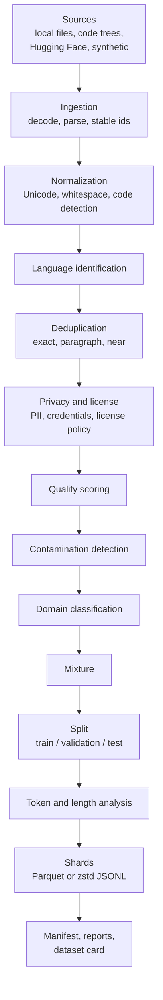

# Architecture overview

DataForge-LLM turns heterogeneous raw sources into immutable, validated, model-ready
datasets. Every stage is configured in YAML, every document keeps its provenance, and every
dataset version is content-addressed.

## Data flow



The order above is the default `stage_order` (see [pipeline](pipeline.md)); it can be
reordered in configuration subject to dependency validation.

## Layers

```text
CLI (dataforge.cli)                    argument parsing, rendering, exit codes
  |
Application (dataforge.pipelines.runner, dataforge.inspection)
  |                                    plan, execute, shard, report, validate, publish
Pipeline core (dataforge.pipelines)    stage contracts, graph, executor, checkpoints
  |
Domain (dataforge.domain, dedup, privacy, quality, contamination, ...)
  |                                    pure algorithms over Document objects
Ports (SourceReader, Parser, StorageBackend, LanguageDetector, TokenEstimator,
  |    LearnedQualityModel)
Adapters (local/code/HF/synthetic readers, LocalStorage, FsspecStorage,
          Parquet parts and shards, DuckDB analytics, optional py3langid/tokenizers)
```

Rules that keep the layers honest:

- Domain packages take and return `Document` objects and plain Python/numpy values. They do
  not import the CLI, DuckDB, or Hugging Face libraries.
- Optional integrations (Hugging Face `datasets`, `tokenizers`, `py3langid`, `s3fs`) are
  imported lazily inside their adapter and raise `OptionalDependencyMissing` with the extra
  to install.
- Configuration is validated once at the edge (Pydantic, `extra="forbid"`); the hot path uses
  slotted dataclasses.

## Package map

| Package | Responsibility |
| :--- | :--- |
| `config` | Pydantic models for sources, stages, sharding, storage; YAML loading with `base_dir` resolution and stage includes; the output-affecting config hash |
| `domain` | `Document`, `DocumentMetadata`, `Provenance`, `ContentKind`; xxh3/SHA-256 hashing and stable document ids |
| `sources` | Source registry, readers (local, code, Hugging Face, synthetic), root-confined file discovery, in-place archive streaming |
| `parsing` | Byte decoding with BOM handling and charset detection, format tables, HTML text extraction, parser registry |
| `ingestion` | Streaming conversion of records to documents with a resumable cursor and structured record errors |
| `normalization` | Conservative, idempotent text normalization |
| `classification` | Language detection port and built-in detector, code detection, rule-based domain classifier |
| `dedup` | Shingling, MinHash, LSH tuning, union-find, Bloom filter, exact / paragraph / near deduplicators |
| `privacy` | PII and credential detectors, overlap resolution, typed redaction |
| `licensing` | SPDX normalization and license / usage-policy gate |
| `quality` | Fifteen heuristic signals, scorer, learned-model plug-in |
| `contamination` | Benchmark registry, n-gram and MinHash indexes, detector |
| `tokenization` | Character, word, and Hugging Face token estimators |
| `mixtures` | Deterministic domain mixture builder |
| `splitting` | Group-aware, deterministic split assignment |
| `storage` | Canonical Arrow schema, Parquet parts, storage backends, disk budget |
| `sharding` | Size-bounded shard writers |
| `provenance` | Dataset manifest models and code identity |
| `validation` | Dataset integrity checks |
| `pipelines` | Stage contracts and adapters, graph, executor, checkpoints, run service |
| `reporting` | Markdown report, dataset card, SVG plots, DuckDB analytics |
| `telemetry` | Structured JSON-lines logging, memory sampling |
| `synthetic` | Deterministic sample corpus, benchmark items, and unbounded document stream |
| `cli` | The `dataforge` command |

## A run, end to end

1. `prepare` loads the pipeline config, resolves sources, validates the stage graph, and
   builds stage objects. No data is read.
2. The disk budget is estimated against free space minus the configured reserve.
3. Every source is described and fingerprinted (file SHA-256 for local sources, pinned
   revision for Hugging Face).
4. Segment fingerprints are chained from the source fingerprints, the code fingerprint, and
   each stage's configuration and external resources. The dataset version is derived from
   the last one; if that version already exists, the run stops with status `exists`.
5. Segments execute in order (see [pipeline](pipeline.md)). Each writes checkpointed
   Parquet parts in the work directory.
6. The final materialization is sharded into a staging directory; reports, the dataset card,
   and the manifest are written; the staged dataset is validated.
7. Only a dataset that passes validation is published, by an atomic directory rename, to
   `<output_dir>/<pipeline name>/<version>/`.

Command reference: run `dataforge --help`; every subcommand documents its options.
